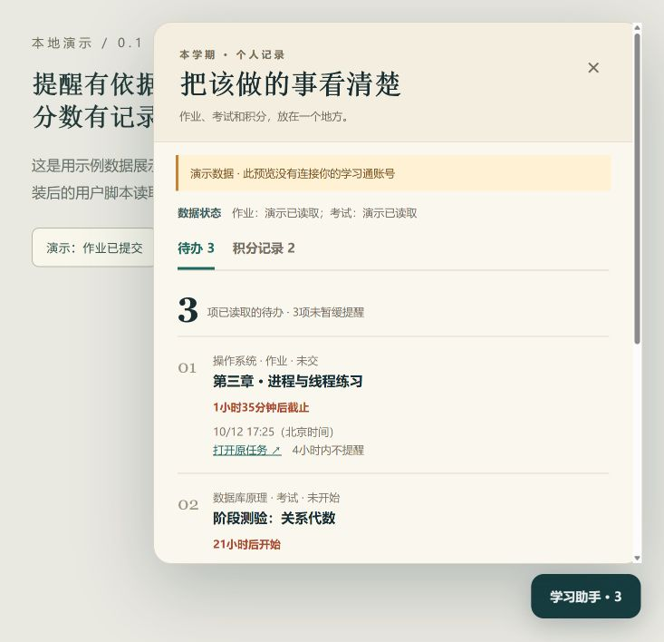
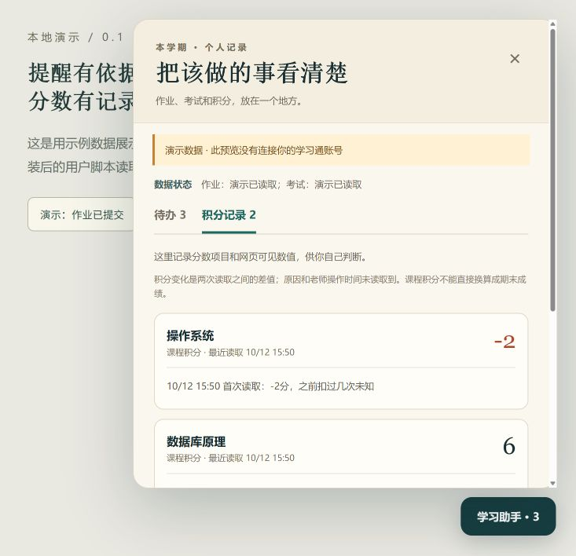

# 学习通个人助手

把未交作业、考试和课程积分放在一个地方，临近截止时提醒你。

面向电脑端 **Microsoft Edge + Tampermonkey（篡改猴）** 的用户脚本，基于 [Cooanyh/chaoxing-list](https://github.com/Cooanyh/chaoxing-list) 扩展。你在学习通网页登录自己的账号，助手读取网页与平台返回的数据，无需另交账号密码。

**当前版本：0.1.0，初期版本。** 已完成本地规则测试与演示页面检查；真实账号的完整课程覆盖率和 Edge 桌面通知仍需逐项核对。提醒需要仪表盘页面保持打开。

[安装脚本](https://raw.githubusercontent.com/lhsdsg666-png/xuexitong-study-assistant/main/学习通个人助手.user.js) · [完整安装与使用教程](使用说明.md) · [版本下载](https://github.com/lhsdsg666-png/xuexitong-study-assistant/releases) · [验证记录](验证记录.md)

## 能做什么

| 功能 | 实际行为 |
| --- | --- |
| 待办汇总 | 展示读取到的未交作业、待互评、未完成考试和课程任务，按已知时间排序 |
| 打开原任务 | 从助手进入学习通原任务页面，自己完成并提交 |
| 桌面提醒 | 已授权通知时，在距截止或开始时间 24 小时、2 小时内分别提醒一次 |
| 暂缓提醒 | 某项任务 4 小时内不提醒 |
| 自动更新 | 页面打开时，每 15 分钟刷新作业、考试和课程活动 |
| 课程积分 | 显示课程积分当前值，并保留负号，例如 `-2` |
| 积分变化记录 | 从第一次读取开始，记录两次有效读数之间的净变化 |
| 手动补充 | 自己填写课堂积分、平时成绩、签到分等加扣分及原因 |
| 导出记录 | 将积分记录导出为本地 JSON 文件 |
| 读取状态 | 读取失败时保留旧数据并提示，不能把失败当作“全部完成” |

### 功能预览

以下截图使用**演示数据**，不包含真实账号、学校或课程记录。

| 待办 | 积分记录 |
| --- | --- |
|  |  |

## 五步开始使用

1. 从 [Edge 官方扩展商店](https://microsoftedge.microsoft.com/addons/detail/tampermonkey/iikmkjmpaadaobahmlepeloendndfphd) 安装 **Tampermonkey**。
2. 在 `edge://extensions` 中找到 Tampermonkey，进入详细信息并开启 **允许用户脚本**；没有这个开关时，按 [官方权限说明](https://www.tampermonkey.net/faq.php?locale=zh&q=Q209) 开启扩展页面的 **开发者模式**。
3. 点击上方 **安装脚本**，在篡改猴安装页面确认安装。如果只看到源码，用教程中的“手动安装”方法。
4. 在 [学习通个人空间](https://i.chaoxing.com/) 登录，再打开 [学习助手仪表盘](https://mooc1-api.chaoxing.com/work/stu-work#chaoxing-dashboard)。安装后若已有该网页打开，按 **F5** 刷新。
5. 点击右下角 **学习助手**。需要通知时，点击 **开启桌面提醒**，并在浏览器提示中允许通知。

只有普通作业列表、没有助手按钮？先查看 [教程：安装后没有面板](使用说明.md#安装后只有普通作业列表没有助手)。

## 积分记录怎样理解

首次读到 `-2`，表示这个课程的 **课程积分目前是 -2**，之前扣过几次未知。之后从 `-2` 变成 `-4`，记录为“观察到减少 2 分”。变化时间是助手观察到的时间，老师实际操作的时间和原因未读取到。

当前版本**没有自动读取平台逐笔加扣分明细**，也不会把课程积分直接换算成期末成绩。你确认了某次扣分的项目、日期和原因后，可以手动补充；手填记录单独展示，不叠加到网页数值。

## 使用条件与数据

- 保持仪表盘页面打开、电脑运行和账号登录有效。关闭该页、关闭浏览器或电脑休眠后，用户脚本无法持续检测；后台标签页也可能被浏览器限速。
- 仅根据实际读到的数据提醒；课程类型、分页、教师未公开内容或平台改版可能造成遗漏。第一次使用请与原课程页核对。
- 新增模块的积分历史、手填记录和提醒设置保存在当前浏览器的网站 `localStorage`，不上传到 AI 或另外的业务服务器。
- 脚本向超星读取已登录账号的数据；原底座还会加载声明的 Vue/Vuetify 等前端依赖。仓库不包含登录态、Cookie 或学生个人数据。
- 切换学习通账号时，使用新的 **记录档案** 并清理原仪表盘课程缓存；清除网站数据会清除本地记录，重要积分记录请先导出。
- 脚本提供查看和提醒，不会代你签到、答题或提交作业。

## 本地演示与开发

安装用户脚本不需要 Python、Node.js 或 npm。下面的命令只供开发者使用。

```bash
git clone https://github.com/lhsdsg666-png/xuexitong-study-assistant.git
cd xuexitong-study-assistant
python source/build.py
node --check 学习通个人助手.user.js
node --test source/coach.test.cjs
```

项目无需安装 npm 依赖。规则测试可使用 Node.js 24；构建脚本可使用 Python 3.11。

预览只展示模拟数据：

```bash
python -m http.server 8765 --bind 127.0.0.1
```

打开 `http://127.0.0.1:8765/preview.html`，可演示提交后待办减少、积分变化和读取失败。预览不连接学习通账号。

| 文件 | 用途 |
| --- | --- |
| `学习通个人助手.user.js` | 构建后的可安装脚本 |
| `source/upstream.user.js` | 固定版本的原上游源码 |
| `source/coach.js` | 本项目的提醒与积分记录模块 |
| `source/build.py` | 合并源码并修补上游的构建脚本 |
| `source/coach.test.cjs` | 规则与构建回归测试 |
| `provenance.json` | 上游提交、版本和文件校验值 |
| `使用说明.md` | 安装、使用与常见问题 |
| `验证记录.md` | 已验证内容与实际平台验证缺口 |

## 来源、许可与反馈

上游为 [Cooanyh/chaoxing-list](https://github.com/Cooanyh/chaoxing-list) 2.4.9，固定提交 [`dd823449f0942f006e70721ddfc214659f406756`](https://github.com/Cooanyh/chaoxing-list/commit/dd823449f0942f006e70721ddfc214659f406756)；上游又基于 [lcandy2/user.js 的学习通脚本](https://github.com/lcandy2/user.js/tree/main/websites/chaoxing.com/chaoxing-assignment)。感谢原作者与维护者 lcandy2、Coren。

本项目新增桌面提醒、本地积分记录、读取失败状态和负数积分解析修复。保留原作者署名、原始源码和 [AGPL-3.0 许可证全文](LICENSE)，脚本声明为 **AGPL-3.0-or-later**。修改说明见 [CHANGELOG.md](CHANGELOG.md)。

发现漏读、时间错误或页面不兼容，可以提交 [Issue](https://github.com/lhsdsg666-png/xuexitong-study-assistant/issues)。请写清浏览器版本、脚本版本、原页面状态和助手状态；截图遮住姓名、头像、学号及带个人参数的网址，不上传 Cookie 或完整登录链接。开发贡献见 [CONTRIBUTING.md](CONTRIBUTING.md)。
